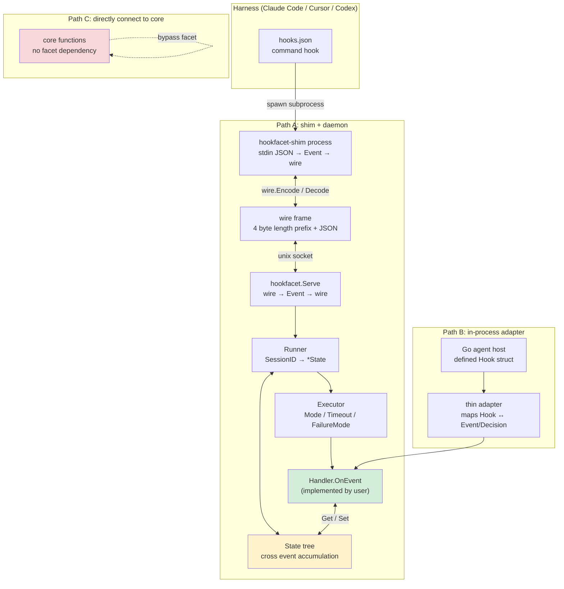
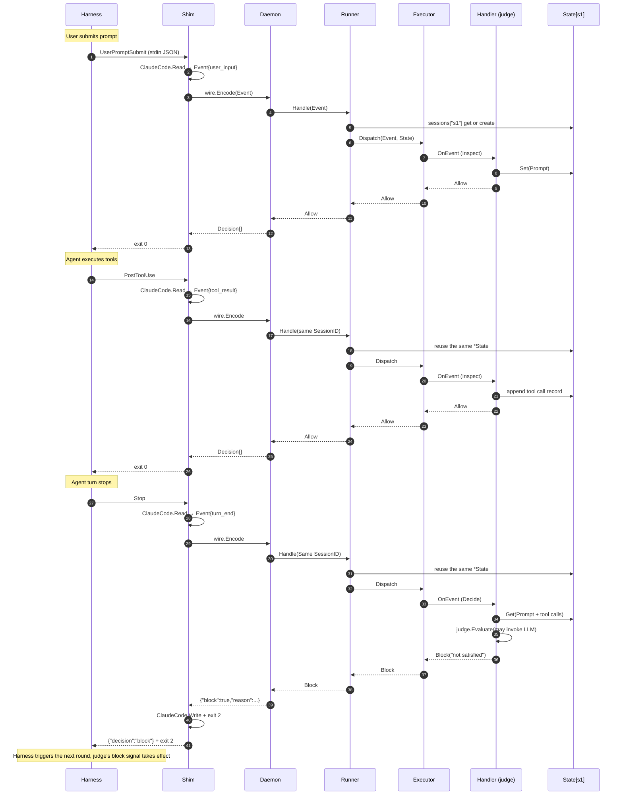

[](https://github.com/ironsweet/hookfacet/actions/workflows/ci.yml)
[](https://pkg.go.dev/github.com/ironsweet/hookfacet)

# hookfacet

A Go library for building agent capabilities that can hook into existing agent products or be built into Go agents.

## Why

If you're building agent harness / capabilities that need to work across Claude Code, Cursor, and Codex -- and also
inside your own Go agent -- without maintaining a separate adapter for each combination, hookfacet gives you a single
`Handler` interface and a shim that handles the wire plumbing.

See [Design Notes](#design-notes) for the trade-offs behind this design.

## How it works

### Component View



### Sequence View



The key takeaway is `State[s1]` -- the same tree is reused across all three events, which is how the handler accumulates
tool calls without managing its own session map. `Inspect` handlers record state but cannot block; only `Decide` 
handlers on `turn_end` can emit `Block`.

## Quick Start

1. Implement a `Handler`

```go
package mymodule

import (
	"context"
	"time"

	"github.com/ironsweet/hookfacet"
)

type Handler struct{}

func (h *Handler) Mode(kind hookfacet.EventKind) hookfacet.HookMode {
	if kind == hookfacet.KindTurnEnd {
		return hookfacet.ModeDecide
	}
	return hookfacet.ModeInspect
}
func (h *Handler) FailureMode() hookfacet.FailureMode { return hookfacet.FailOpen }
func (h *Handler) Timeout() time.Duration             { return 5 * time.Second }
func (h *Handler) OnEvent(ctx context.Context, ev hookfacet.Event, st *hookfacet.State) (hookfacet.Decision, error) {
	switch ev.Kind {
	case hookfacet.KindToolResult:
		// Production code suggests using a typed struct (type toolCalls struct{ n int }) as key
		// to avoid collisions of multiple int counters.
		n, _ := hookfacet.Get[int](st)
		hookfacet.Set(st, n+1) // cross-event accumulation, no need to manage your own state
	case hookfacet.KindTurnEnd:
		if n, _ := hookfacet.Get[int](st); n == 0 {
			return hookfacet.Block("no tool call this turn"), nil
		}
	}
	return hookfacet.Allow(), nil
}
```

2. Start a daemon

```go
package mymodule

import (
	"context"
	"log/slog"
	"os"

	"github.com/ironsweet/hookfacet"
)

// Handler is defined in the previous step

func main() {
	ctx := context.Background()
	logger := slog.New(slog.NewTextHandler(os.Stderr, nil))
	hookfacet.Serve(ctx, "/tmp/my.sock", hookfacet.NewRunner(&Handler{}), logger)
}
```

3. Configure your agent

```shell
go install github.com/ironsweet/hookfacet/cmd/hookfacet-shim@latest
```

```json
{ "hooks": {
  "UserPromptSubmit": [{ "hooks": [{ "type": "command", "command": "hookfacet-shim" }] }],
  "PostToolUse": [{ "hooks": [{ "type": "command", "command": "hookfacet-shim" }] }],
  "Stop": [{ "hooks": [{ "type": "command", "command": "hookfacet-shim" }] }]
} }
```

```shell
export HOOKFACET_SOCKET=/tmp/my.sock
```

## Design Notes

Three integration patterns are supported: Path A (shim + daemon) is the primary path; Path B (in-process adapter) is a
reference adapter; Path C (direct call to module core) bypasses facet entirely. 

This is chosen because path A is how off-the-shelf agent products like Claude Code can use the same agent capability I
built. Path B is how my own agent can use the same capability without the overhead of IPC. Path C is actually reserved 
for capability extension.

I researched several hook frameworks and chose Claude Code's event protocol as the de-facto standard. They share the
same JSON-in/JSON-out shape but differ in event names, which is why `EventKind` is abstracted into a normalized enum.

LLM and Agent runtime APIs are intentionally out of scope. Most capabilities need access to a full agent run API
(like Claude Code's `prompt` hook but with more flexibility), which belongs to the module, not to a hook contract 
library. See [Not Included](#not-included) for the full boundary.

## Not Included

- **LLM / Agent runtime abstraction**: modules manage their own LLM access.
- **HTTP hook**: only Claude Code and Copilot CLI support it natively; Cursor and Codex do not. `command` hook is the   
  only fully cross-harness path.
- **Non-Claude-Code adapters**: `Cursor` and `Codex` adapters are planned, not included in v0.
- **Session cleanup**: `Runner.sessions` grows unbounded; session eviction is not yet implemented. Long-running 
  deployments should plan for periodic daemon restart until this is addressed.
